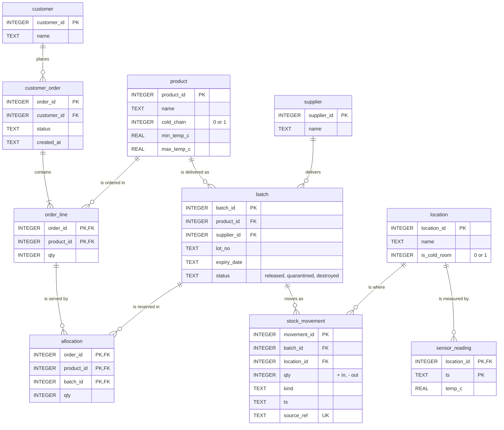

# ER diagram: schema v1

Back to the [README](../README.md) · Source of truth: [`schema.sql`](schema.sql) · Design notes: [`notes.md`](notes.md)

GitHub draws this diagram automatically. Notation: `||--o{` = one to many (one on the left, zero or more on the right).

## The two m:n relationships

| Between | Bridge table | Why |
|---|---|---|
| `customer_order` and `product` | `order_line` | An order contains many products, and a product appears in many orders |
| `order_line` and `batch` | `allocation` | One order line can be served from several batches (FEFO), and one batch serves many order lines |
